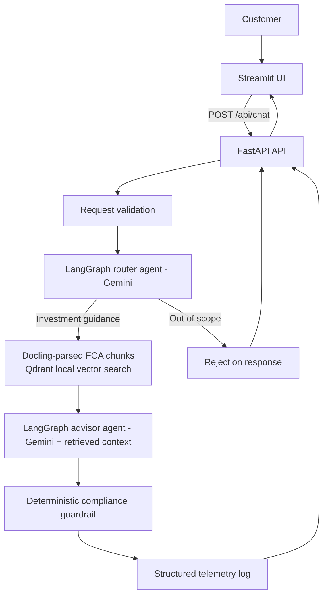

# Invest AI

A local demo of an AI-powered investment and pension education assistant. The
project includes a Streamlit chat UI, a FastAPI backend, and a LangGraph workflow
that routes customer questions to a Gemini-backed guidance agent and a
deterministic response guardrail.

> **Important:** This is an educational prototype, not financial advice or a
> production-ready regulated service. Its prompt-based routing and phrase-based
> guardrail do not establish FCA or Consumer Duty compliance.

## Architecture



### Components

- `app.py` — Streamlit chat UI. Maintains display history in the browser
  session and sends each submitted question to the local API.
- `run_server.py` — Starts the local FastAPI backend on `127.0.0.1:8000`.
- `invest_ai/api.py` — API routes (`/health`, `/api/chat`) and HTTP error mapping.
- `invest_ai/contracts.py` — Pydantic request, response, and graph-state schemas.
- `invest_ai/agents.py` — Gemini client, router agent, advisor agent, and bounded
  retries for temporary 503 errors.
- `invest_ai/graph.py` — LangGraph workflow and routing between agent/guardrail
  nodes.
- `invest_ai/rag.py` — Docling PDF conversion/chunking and local Qdrant vector
  indexing/retrieval using local FastEmbed embeddings.
- `invest_ai/ingest.py` — CLI for indexing the FCA PDF sources.
- `invest_ai/compliance.py` — Prototype phrase checks and fallback response.
- `invest_ai/orchestrator.py` — Validates requests, invokes the graph, and emits
  summary telemetry to application logs.
- `test_gemini_api.py` — Small script to check Gemini API connectivity.
- `data/rag_sources/SOURCES.md` — Official FCA PDF source list for local RAG
  experiments. The downloaded PDFs are excluded from Git.

The in-scope path uses two Gemini calls: one to classify intent and one to draft
general educational guidance grounded in retrieved FCA passages. Docling
preserves document layout and table structure before hybrid chunking. Qdrant
stores vectors locally; FastEmbed generates embeddings locally. The out-of-scope
path returns a rejection without document retrieval or an advisor call. The
compliance node is deterministic and does not call an LLM.

## Requirements

- Python 3.11 or later
- A Google AI Studio Gemini API key
- Internet access for first-time Docling/OCR and local embedding model
  downloads, plus the optional figure-description model

## Local setup

From the project root:

```bash
python3 -m venv .invest_ai
source .invest_ai/bin/activate
python -m pip install -r requirements.txt
```

Create or edit `.env` in the project root and set `GEMINI_API_KEY` to your own
key. Do not commit `.env` or paste API keys into source files, screenshots,
issue trackers, or chat. The `.gitignore` excludes `.env` and common local
virtual environments.

The FCA PDFs are intentionally excluded from Git. Download them from the
official source links listed in
[`data/rag_sources/SOURCES.md`](data/rag_sources/SOURCES.md) into
`data/rag_sources/` before indexing.

Optional configuration:

```env
GEMINI_MODEL=gemini-3.5-flash-lite
INVEST_AI_API_URL=http://127.0.0.1:8000
```

## Manage prompts with MLflow

The router and advisor use the built-in instructions by default. To version
prompts and select registered versions at runtime, configure MLflow's tracking
URI (defaults to a local `sqlite:///mlflow.db`) and register the initial prompt
versions:

```bash
python -m invest_ai.prompts register-defaults
```

The command prints the version URIs it created, for example
`prompts:/invest-ai-router/1` and `prompts:/invest-ai-advisor/1`. Set the
selected versions in `.env`:

```env
MLFLOW_TRACKING_URI=sqlite:///mlflow.db
INVEST_AI_ROUTER_PROMPT_URI=prompts:/invest-ai-router/1
INVEST_AI_ADVISOR_PROMPT_URI=prompts:/invest-ai-advisor/1
```

Start the MLflow UI against the same local store in another terminal:

```bash
mlflow server --backend-store-uri sqlite:///mlflow.db --host 127.0.0.1 --port 5001
```

Open `http://127.0.0.1:5001` to inspect and compare versions. To register new
versions with few-shot examples, run:

```bash
python -m invest_ai.prompts register-few-shot
```

The command prints the newly created version URIs. Review them in MLflow and
update the selected version URI before restarting the API. An unset prompt URI
continues to use the built-in prompt; a configured but unavailable/invalid
registry prompt fails explicitly during API initialization. Prompt versioning
does not replace the deterministic response guardrail or review of financial
guidance changes. This integration registers and loads prompt templates only;
it does not enable MLflow tracing/evaluation or log customer conversations to
MLflow.

To register additional isolated technique variants, run:

```bash
python -m invest_ai.prompts register-techniques
```

This creates new versions under the existing router and advisor prompt names:
task decomposition, silent self-check, output constraints, and (for the advisor)
stronger RAG grounding. Each candidate adds one technique to the base instruction
so comparisons are easier to interpret. The few-shot versions are registered
separately with `register-few-shot`. These commands only register candidates;
they do not activate them. Inspect and evaluate versions against representative
and held-out examples before changing the prompt URIs in `.env`. Chain-of-thought
traces are intentionally not requested or exposed.

Starter prompt-evaluation JSONL files are in
[`data/prompt_eval/`](data/prompt_eval/). They separate router/advisor training
examples from small holdout sets. Advisor examples include retrieved passages
snapshotted from the local Qdrant index. See that folder's README for the schema
and evaluation caveats.

### Benchmark prompt versions offline

With `GEMINI_API_KEY` set, compare prompt versions against the held-out examples
and log a separate MLflow run for each version:

```bash
python -m invest_ai.prompt_evaluate \
  --skip-advisor \
  --router-uris prompts:/invest-ai-router/1 prompts:/invest-ai-router/2 prompts:/invest-ai-router/4

python -m invest_ai.prompt_evaluate \
  --skip-router \
  --advisor-uris prompts:/invest-ai-advisor/1 prompts:/invest-ai-advisor/2 prompts:/invest-ai-advisor/7
```

The command uses the configured `MLFLOW_TRACKING_URI` (or local
`sqlite:///mlflow.db`) and the `*_holdout.jsonl` files by default. Use
`--split train` while iterating, then compare finalists with the untouched
holdout set. Results appear under the `invest-ai-prompt-benchmark` experiment;
each run records the prompt URI, summary metrics, and an
`evaluation_results.json` artifact with per-case outputs and checks.

Router metrics include exact intent accuracy and mean latency. Advisor metrics
include required-citation coverage, citations restricted to supplied passages,
basic risky-phrase checks, LLM-judged groundedness and answer relevancy, plus
context precision and recall from hand-reviewed labels. Set
`PROMPT_EVAL_JUDGE_MODEL` to choose a Gemini model for answer-quality judging;
by default the configured `GEMINI_MODEL` is used. These judge calls invoke
Gemini and add API cost. Scores and per-case judge rationales are stored in the
MLflow run artifact. Judge scores are approximate and must be manually reviewed;
they do not establish factuality or compliance.

Context precision/recall evaluate the fixed retrieval snapshots and curated
evidence labels, so they do not vary between prompt versions using the same
cases. The current examples each contain one retrieved passage, making context
precision especially limited; add multi-passage cases before drawing retrieval
quality conclusions. Evaluating does not require the MLflow UI/server to be
open if using the local SQLite tracking store. The current holdout set is tiny,
so treat scores as a workflow smoke test, not a reliable estimate of production
quality.

### Fail deployment when a prompt regresses

Use the prompt gate as a pipeline stage after the candidate prompt is registered
and before deployment. It runs baseline and candidate on the same holdout file,
logs both evaluations to MLflow, and exits with status `1` if the candidate is
below the configured minimum or regresses on a gated quality metric. Evaluation
configuration or service errors exit with status `2`.

For example, for the advisor:

```bash
python -m invest_ai.prompt_gate \
  --task advisor \
  --baseline-uri prompts:/invest-ai-advisor/1 \
  --candidate-uri prompts:/invest-ai-advisor/7
```

The router equivalent uses `--task router` and router prompt URIs. Current
minimum holdout thresholds are 100% router intent accuracy; for the advisor,
100% required-citation, allowed-citation, and risky-phrase checks, plus at least
0.8 for groundedness, answer relevancy, context precision, and context recall.
The candidate must also be no worse than the pinned baseline on each gated
metric. Context scores are included as a fixed-data gate, not evidence that a
prompt improved retrieval. Latency is reported but is not currently a release
blocker.

Configure `GEMINI_API_KEY` and `MLFLOW_TRACKING_URI` as protected CI secrets or
environment variables. The CI runner must be able to reach the Gemini API and
the same MLflow registry containing both prompt versions; the local
`sqlite:///mlflow.db` store is not automatically available on a remote runner.
Make this command a required pre-deploy stage so its non-zero exit status blocks
deployment. This repository has no Jules or Spinnaker pipeline definition, so
the command is provider-neutral and must be inserted in the pipeline that owns
deployment. The holdout set is currently tiny, and advisor checks are
heuristics: expand and review the dataset before using this as a production
quality or compliance gate. The LLM judge also needs Gemini API access and can
vary between runs; consider repeated runs and human review for release decisions.

## Build the local RAG index

Do this before starting the API. If the API is already running, stop it first:
Qdrant local storage uses a single-process file lock. With the virtual
environment active and the source PDFs in `data/rag_sources/`, run:

```bash
python -m invest_ai.ingest
```

Docling parses layout, headings, tables, and page provenance. It indexes figure
captions/text exposed by the PDF parser. To generate descriptions for visual
figures and charts with Docling's local vision model (slower; downloads another
model on first use), run:

```bash
python -m invest_ai.ingest --describe-pictures
```

The local Qdrant database is stored in `data/qdrant/` and ignored by Git.
Re-index after changing source documents.
Retrieved passages are sent as context to the advisor, and the UI shows
document/page references. RAG search returns HTTP 503 with setup guidance when
no PDFs have been indexed.

## Run the application

Start the backend in terminal 1:

```bash
source .invest_ai/bin/activate
python run_server.py
```

The API listens on `http://127.0.0.1:8000` (loopback only). Check health at
`http://127.0.0.1:8000/health` and open interactive API documentation at
`http://127.0.0.1:8000/docs`.

Start the Streamlit UI in terminal 2:

```bash
source .invest_ai/bin/activate
streamlit run app.py
```

Streamlit prints the local browser URL, usually `http://localhost:8501`.

### Sample questions to try

The intent router only handles questions whose primary topic is UK pensions,
ISAs, investing, or investment risk. Questions about general customer support or
Consumer Duty without a connection to those topics may be rejected as out of
scope. The router runs before document retrieval, so having a topic covered by
the FCA source PDFs does not by itself make a question in scope.

Try these questions in the UI:

- How do pension contributions work?
- What’s the difference between a defined contribution and a defined benefit pension?
- What should I understand before transferring a pension?
- What questions should I ask a regulated adviser before making a pension decision?
- What does diversification mean, and why does it matter?
- How do risk and potential returns relate?
- What is the difference between saving and investing?
- What should a beginner learn before investing?
- What information might help someone understand their pension options?
- How might Consumer Duty affect the support a firm provides when someone is making a pension decision?

This is an educational demo, not financial advice. Do not enter real customer
or sensitive personal information.

## API

`POST /api/chat` accepts:

```json
{
  "context": {
    "customer_id": "DEMO-CUSTOMER",
    "age_band": "35-50",
    "investor_experience": "Intermediate",
    "has_pension": true
  },
  "query_text": "How do pension contributions work?"
}
```

The API validates the payload, runs the LangGraph workflow, and returns either
a guidance response with compliance metadata or an out-of-scope rejection.
Invalid request fields return HTTP 422. Temporary Gemini unavailability is
retried up to three total attempts; if all attempts fail, the API returns HTTP
503.

## Demo limitations

- The router and advisor are separate calls to a Gemini model; the compliance
  guardrail is a regular-expression check. This is a role-based LangGraph demo,
  not a fully autonomous production multi-agent system.
- Gemini Developer API is used. Vertex AI, BigQuery writes, Cloud Run
  deployment, and CI/CD gates are not implemented here.
- Telemetry is emitted through Python logging. It is not persisted to BigQuery.
- The UI retains visible chat history, but only the latest question and current
  profile are sent for each API request; prior messages are not model context.
- The chat UI accepts user profile fields for demonstration. Do not enter real
  customer or sensitive personal information.
- This prototype is not a substitute for compliance, legal, security, privacy,
  or financial-services review.

## RAG source PDFs

Three FCA publications are downloaded locally under `data/rag_sources/` as
starter material. Their source URLs and intended scope are documented in
[`data/rag_sources/SOURCES.md`](data/rag_sources/SOURCES.md). The PDFs are ignored by Git; retrieve current copies from the FCA links and
verify versions before indexing. This repository includes a local
Docling/Qdrant ingestion and retrieval prototype, not a managed or
production-scale knowledge service.
